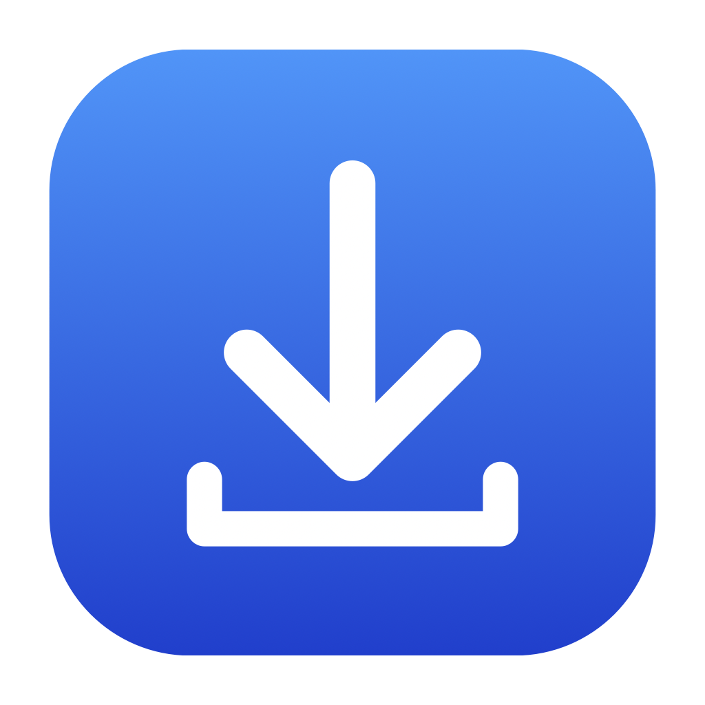
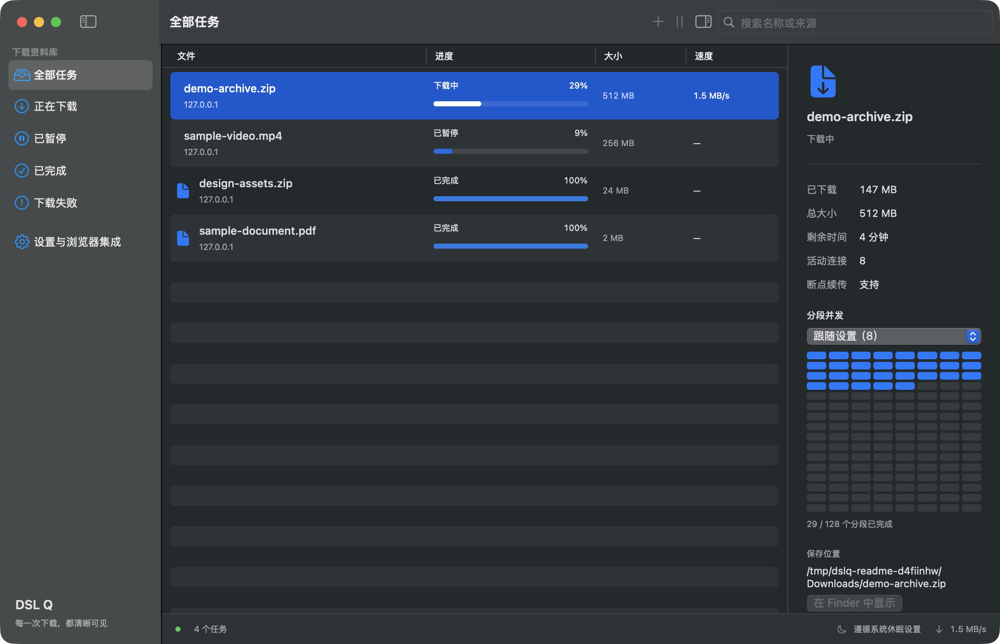
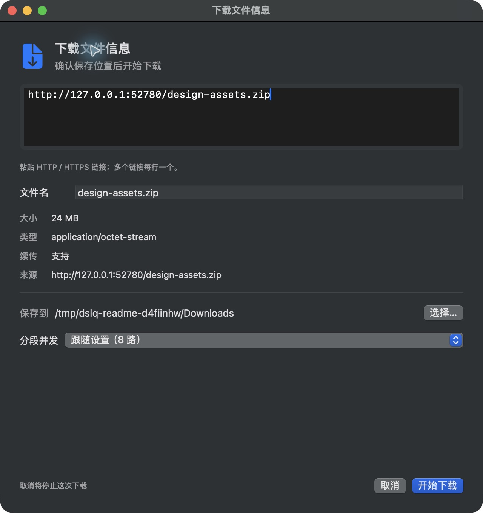
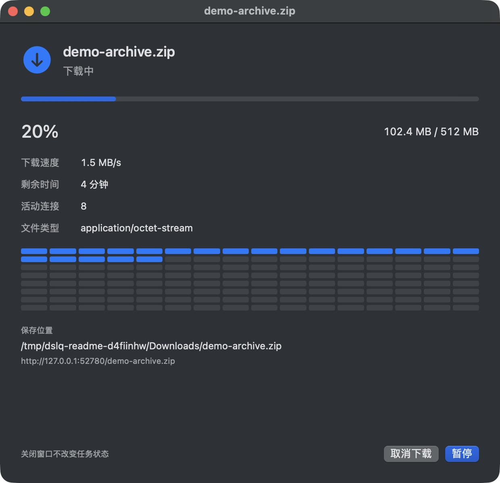

<p align="center">
  
</p>

<h1 align="center">DSL Q</h1>

<p align="center">面向 macOS 的原生下载器，让每一次下载都清晰可见。</p>
<p align="center"><strong>SwiftUI · Go · Chrome 扩展</strong><br>macOS 14+ · Apple Silicon · GPL-3.0-only</p>

<p align="center">
  <a href="https://github.com/xnqycs/DSL_Q/actions/workflows/build.yml"></a>
  <a href="https://github.com/xnqycs/DSL_Q/releases">下载 Release</a>
</p>

<p align="center">
  <a href="#功能">功能</a> ·
  <a href="#界面预览">界面预览</a> ·
  <a href="#快速开始">快速开始</a> ·
  <a href="#chrome-集成">Chrome 集成</a> ·
  <a href="#开发">开发</a>
</p>



> 自动构建和 Release 产物仅作 ad-hoc 签名，未经过 Apple Developer ID 签名或公证。首次打开可能被 macOS 安全机制拦截；请仅运行你信任来源的版本。

## 功能

| 功能 | 说明 |
| --- | --- |
| 分段下载 | 单任务支持 **1–32 路并发**，默认 8 路；默认同时下载 3 个任务，可设置全局限速。 |
| 暂停与恢复 | 暂停、继续、失败重试；退出时保存进度，下次启动恢复原先运行的任务。续传能力取决于服务器支持。 |
| 独立进度窗口 | 每项下载单独显示速度、大小、剩余时间和分段状态；关闭窗口后仍继续下载。 |
| Chrome 接管 | 按文件大小、扩展名和站点规则接管，也可通过右键菜单或扩展弹窗发送链接。 |
| 开始前确认 | 查看文件信息，调整文件名、保存目录和并发数，再开始传输；支持逐项确认多个链接。 |
| 后台与通知 | 菜单栏操作、开始和结束通知，以及可选的下载期间防自动休眠。 |
| 本地数据保护 | 任务和设置加密保存，密钥存入 macOS 钥匙串；保存完成文件时不覆盖已有文件。 |

支持 HTTP / HTTPS 文件下载和显式 HTTP / SOCKS5 代理。当前不支持 Intel Mac、Safari 集成、BT、FTP 或网页媒体解析。

## 界面预览

<table>
  <tr>
    <th width="50%">开始前确认</th>
    <th width="50%">独立下载进度</th>
  </tr>
  <tr>
    <td valign="top"></td>
    <td valign="top"></td>
  </tr>
</table>

截图为隔离环境中的真实运行画面。文件、链接和目录均为本地演示数据，截图中的速度不代表性能测试结果。

## 快速开始

如果 [Releases](https://github.com/xnqycs/DSL_Q/releases) 已有发布版本，可下载 `DSL-Q-vX.Y.Z-macos-arm64.zip`，解压后将 `DSL Q.app` 放入“应用程序”。直接使用构建好的应用不需要安装 Go、Node.js 或 Swift 工具链。以下步骤用于从源码构建。

### 1. 准备环境

| 项目 | 要求 |
| --- | --- |
| Mac | Apple Silicon，macOS 14 或更新版本 |
| 原生构建 | Swift 6、macOS SDK、Xcode Command Line Tools |
| 下载核心 | Go 1.26+ |
| 扩展构建 | Node.js 22+、npm |
| 浏览器集成（可选） | Chrome 120+ |

已验证的构建环境为 macOS / SDK 27.2、Swift 6.4.2、Go 1.27.3 和 Node.js 22.23.4（npm 10.9.9）。这是当前验证组合，不代表最低构建工具链要求；应用运行目标仍为 macOS 14+，其他工具链组合尚未逐一验证。

### 2. 构建并打开

在仓库根目录执行：

```sh
./scripts/build.sh
open 'dist/DSL Q.app'
```

脚本会安装扩展的锁定依赖，构建 SwiftUI 应用、Go 核心及浏览器连接组件，并组装完整的 `.app`。

### 3. 开始第一项下载

1. 按 **⌘N**，粘贴 HTTP / HTTPS 文件链接；多个链接每行一个。
2. 等待文件信息加载，确认文件名、保存位置和分段并发。
3. 点击 **“开始下载”**，在独立窗口查看进度。

多个链接会逐项确认，同一批次沿用你选择的目录与并发数，不改变全局默认设置。

| 操作 | 结果 |
| --- | --- |
| 双击资料库中的任务 | 重新打开进度窗口；待确认任务会打开确认窗口。 |
| 关闭主窗口或进度窗口 | 下载继续，可从菜单栏重新打开。 |
| 按 **⌘Q** | 保存进度并退出，下次启动恢复任务。 |
| 移除已完成任务 | 只移除记录，保留下载文件。 |

## Chrome 集成

### 首次连接

1. 将 `DSL Q.app` 放到准备长期保留的位置（例如“应用程序”），打开应用的 **“设置与浏览器集成”**。
2. 点击 **“安装连接组件并导出扩展”**。扩展会导出到“下载”中的 `DSL Q Chrome 扩展` 文件夹。
3. 在 Chrome 打开 `chrome://extensions`，开启 **“开发者模式”**，点击 **“加载已解压的扩展程序”**，选择刚导出的文件夹。
4. 在扩展弹窗授权网站访问，确认客户端已连接；在 DSL Q 设置中开启 **“按规则自动接管浏览器下载”**，点击 **“完成”** 保存。

请选择导出的普通文件夹，不要选择 `.app`。找不到目录时，可在应用设置中点击“复制扩展路径”，在 Chrome 的文件选择窗口按 **⌘⇧G** 粘贴。

### 接管规则

- 默认接管 **至少 20 MiB，或匹配 90 种常见扩展名**的文件，可调整阈值、文件类型和排除站点。
- 点击 **“补充常见类型”** 可保留自定义项并补齐预设，修改后点击“完成”保存。
- 手动发送时，右键链接选择 **“使用 DSL Q 下载链接”**，也可在扩展弹窗粘贴链接。
- 成功接管后先显示 DSL Q 的文件确认窗口，点击“开始下载”才传输文件；无需关闭 Chrome 的“下载前询问每个文件的保存位置”。

### 更新与卸载

**保留导出的扩展文件夹**，Chrome 会持续从这里加载。更新应用后，重新点击“安装连接组件并导出扩展”，再到 Chrome 扩展管理页点击 DSL Q 的“重新加载”；导出位置和扩展 ID 保持不变。移动应用后也应重新安装连接组件。

卸载时，先在 DSL Q 设置中移除连接组件，再删除 Chrome 扩展和应用。

## 常见问题

<details>
<summary><strong>为什么某些下载仍由 Chrome 处理？</strong></summary>

自动接管只处理能够唯一关联的 GET 请求。POST、`blob:`、无痕窗口、危险下载、关联有歧义或无法复现认证的请求，会留给浏览器。

如果客户端准备超过 13 秒，本次恢复由 Chrome 处理，迟到的准备结果会撤销。扩展弹窗会显示连接、授权、接管状态，以及最近 20 次下载的处理结果，便于区分规则不匹配、请求关联失败和准备超时等情况。

接管任务安全保存后，Chrome 原任务结束。若已进入 DSL Q 确认窗口，主动取消不会再交回 Chrome；未确认的任务在应用重启后仍需确认。

扩展按请求生命周期、重定向链和响应信息关联下载，无后缀接口也可通过响应中的真实文件名识别。交接中断后会恢复并重试尚未完成的提交。诊断记录只保留在当前浏览器会话，不包含 URL 查询参数或认证请求头；用于复现下载的认证信息不会跨来源转发。

</details>

<details>
<summary><strong>为什么有时不能续传，或没有使用全部并发？</strong></summary>

可靠的分段下载和跨进程续传需要服务器支持 Range，并提供强 ETag，或满足 HTTP 强校验条件的 Last-Modified。缺少可靠校验信息时，DSL Q 会采用单路下载，恢复时从头获取，避免拼接不同版本的文件。

分段大小为 4 MiB，只有数据写入磁盘并同步成功后才记录完成状态。实际速度受站点带宽、连接限制和本地网络影响；32 路是并发上限，不保证每次使用全部连接或固定倍数提速。资源变化时，可使用“从头下载”。

</details>

<details>
<summary><strong>防休眠、通知和代理如何工作？</strong></summary>

- **防休眠**：默认关闭，设置与菜单栏共用同一开关，切换立即生效。仅在下载、重试和保存文件期间保持系统唤醒；允许屏幕熄灭，合盖、主动睡眠和低电量仍由 macOS 处理。全部暂停或完成后自动释放。
- **通知**：开始和结束通知默认开启，可分别关闭。首次开始时请求系统授权，拒绝不会影响下载；点击通知可打开对应任务。暂停、继续、自动重试和重启恢复不会重复发送开始通知，手动重试或从头下载视为新一轮。
- **代理**：留空为直连，已有系统 TUN 仍正常生效。显式 HTTP / SOCKS5 代理修改后用于下一次启动的下载任务。

</details>

<details>
<summary><strong>任务数据保存在哪里？</strong></summary>

任务和设置存放于 `~/Library/Application Support/DSL Q`，以 AES-256-GCM 加密后写入 SQLite，密钥保存在 macOS 钥匙串中。**不要单独删除钥匙串密钥**，否则无法解密已有数据库。

下载文件保存在你选择的目录中，不属于上述加密数据库。完成后会设置 macOS 下载隔离属性。

</details>

## 开发

```text
cmd/              Go 核心与 Native Messaging 桥接入口
internal/engine/  下载调度、限速、文件写入和加密持久化
internal/rpc/     应用及扩展通信
macos/            SwiftUI 界面、钥匙串、通知与电源控制
extension/        Chrome Manifest V3 扩展
scripts/          构建、检查和本地联调
```

运行项目检查：

```sh
./scripts/check.sh
```

检查覆盖 Go 竞态测试、扩展类型检查与测试、Swift 构建及原生组件检查。已有验证结果和未验证范围见 [VALIDATION.md](VALIDATION.md)。

### 自动构建与发布

[Build and Release](.github/workflows/build.yml) 使用 GitHub 的 `macos-26` ARM64 runner，固定 Go 1.27.3 和 Node.js 22.23.4，复用项目构建与检查脚本。

| 触发方式 | 执行内容 |
| --- | --- |
| 推送到 `main`、提交面向 `main` 的 PR | 运行检查，构建应用并上传 Actions 产物，保留 14 天。 |
| Actions 页面手动运行 | 构建并上传产物，不发布 Release。 |
| 推送 `vX.Y.Z` 标签 | 检查和构建通过后，自动发布 GitHub Release。 |
| 推送 `vX.Y.Z-rc.1` 等标签 | 同样构建发布，并标记为 Pre-release。 |

每份产物包含应用 ZIP、独立 Chrome 扩展 ZIP、对应提交的源码归档和 `SHA256SUMS` 校验文件。应用 ZIP 保留可执行权限和签名，许可证随应用与扩展分发。Release 先在草稿中上传附件，再公开发布；重跑不会覆盖已发布版本。

发布新版本时，先将根目录的 [VERSION](VERSION) 改为目标版本并提交，再推送版本标签。例如：

```sh
# 确保 VERSION 已更新为 0.2.2，并已提交本次发布的所有改动
git push origin main
git tag -a v0.2.2 -m "Release v0.2.2"
git push origin v0.2.2
```

标签的基础版本必须与 `VERSION` 一致，否则构建会停止。应用版本读取 `VERSION`，CI 构建号使用 Actions 运行编号；Chrome 扩展版本仍由 `extension/package.json` 管理。发布使用工作流自带的 `GITHUB_TOKEN`，仅发布任务授予 `contents: write`，无需另外配置 GitHub Token。

如需在本地打包，先提交源码改动，构建后运行：

```sh
./scripts/build.sh
./scripts/package.sh
```

文件生成在 `dist/packages/v<版本号>/`。脚本会检查版本、ARM64 架构、签名和许可证；已有同名产物时会停止，避免覆盖。

<details>
<summary><strong>构建细节</strong></summary>

扩展公钥固定在 `extension/public-key.txt`，扩展 ID 由构建脚本计算，无需私钥。应用包内含独立的 Go 核心和 Native Messaging 桥接程序。

macOS 27 SDK 同时导出 `State` 属性包装器与同名宏，而 Command Line Tools 缺少 SwiftUI 宏插件；项目通过 `ViewState` 类型别名选择属性包装器，保持 macOS 14 部署目标。

工作流当前不执行 Developer ID 签名或 Apple 公证。通过网络分发应用或扩展时，须在下载位置提供对应版本的完整源码（包括构建脚本），或清楚标明其获取位置，并满足 GPL 第 6 条的要求；自动发布的源码归档已包含本仓库的构建脚本。

</details>

## 许可证

DSL Q 的原创代码、文档和构建脚本采用 **[GNU GPL v3.0，仅第 3 版](LICENSE)**（`GPL-3.0-only`），覆盖 Go 核心、桥接程序、SwiftUI 应用和 Chrome 扩展。版权与适用范围见 [NOTICE](NOTICE)。

允许个人及商业使用、修改和收费分发。分发受 GPL 覆盖的程序或修改版时，须按 GPL 提供对应源码、保留版权和许可声明，并遵守其余条款；仅供自己使用的修改无需公开。本软件不提供任何担保，具体以许可证原文为准。

第三方组件继续遵循各自许可证，详见 [THIRD_PARTY_NOTICES.md](THIRD_PARTY_NOTICES.md)。构建时会将这三个许可文件带入应用包和导出的扩展；更新依赖或 Go 工具链时，应同步核对第三方许可声明。
